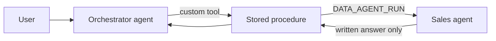
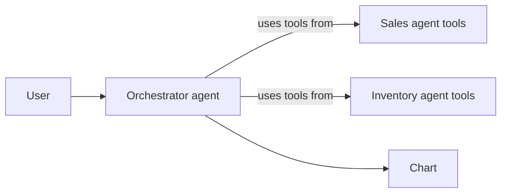
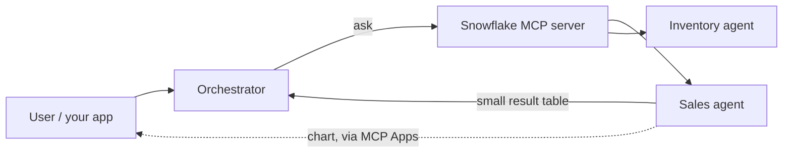

# Multi-Agent Architectures on Snowflake Cortex Agents

When a main ("orchestrator") agent needs help from specialist agents (sales, inventory, finance…),
there are a few ways to connect them. They give the same answers, but they differ a lot in
**cost, speed, and whether charts come through**.

This demo builds each option on the same data, asks them the same questions, and measures the difference.
You can run it in your own account in about 15 minutes.

---

## The three ways to connect agents

### Option 1: Call the specialist agent from a stored procedure

The orchestrator has a custom tool that runs a stored procedure. The procedure calls the specialist
agent and returns its written answer.



- Easy to set up, and works with any agent.
- The specialist's answer comes back as text only. If the user wants a chart, the orchestrator often has to
  ask the specialist again for the raw numbers, and each extra request is a full agent run.

### Option 2: Share the specialist's tools with the orchestrator (`agent_toolset`)

The orchestrator borrows the specialist agents' tools directly, so it can query their data and draw
charts itself.



- One agent run per question, with native charts.
- Each specialist's data model is only loaded when the question needs it.
- Every borrowed tool is listed for the orchestrator. With many specialists (dozens of tools), that list
  gets long and cost goes up.

### Option 3: Call specialist agents through Snowflake's managed MCP server

Each specialist runs on its own and returns only what the orchestrator asks for (for example, just the
result table). With **MCP Apps** (in preview), the specialist's finished chart goes straight to your app.



- Specialists stay independent, and cost stays flat as you add more of them.
- Works with external orchestrators and custom front ends.
- Needs a client that speaks MCP. MCP Apps must be enabled on your account.

---

## What we measured

Same questions, same data, same model (Claude Sonnet). Averages per question:

| | Option 1: Stored procedure | Option 2: Shared tools | Option 3: MCP server |
|---|---|---|---|
| **Cost (tokens)** | ~806K | ~257K | ~256K |
| **Relative cost** | **about 3x** | baseline | about the same |
| **Response time** | ~102 s | ~23 s | ~25 s |
| **Charts** | after re-asking | yes | yes (sent to your app) |
| **With 14 specialist agents** | — | ~1.5x | ~1x |

How to choose:

- **A few specialist agents, using Snowflake Intelligence / CoWork:** Option 2 is the simplest and cheapest.
- **Many specialist agents, or your own app / orchestrator:** use Option 3. Ask for only the result table
  (`content_cel_filter`), and use MCP Apps for charts.
- **Moving off Option 1:** you should see lower cost, faster answers, and more precise numbers.

> One setting to avoid with Option 3: returning the **full** agent response (`content_cel_filter: full`).
> It sends the specialist's entire working notes back to the orchestrator and costs more than the other modes.

Full numbers and method: [docs/findings.md](docs/findings.md) · Slides: [docs/multiagent-delegation-findings.pptx](docs/multiagent-delegation-findings.pptx)

---

## Walkthrough

### 1. Prerequisites

- A Snowflake account with Cortex Agents and Claude Sonnet available
- A warehouse, and a role that can create databases, agents, procedures and MCP servers (ACCOUNTADMIN works)
- A [programmatic access token](https://docs.snowflake.com/en/user-guide/programmatic-access-tokens) for your user
- Python 3.10+ with `pip install snowflake-connector-python requests pandas tabulate`
- Optional: MCP Apps enabled on your account (ask your Snowflake account team)

### 2. Set your connection details

```bash
export SNOWFLAKE_ACCOUNT=<org>-<account>
export SNOWFLAKE_USER=<your_user>
export SNOWFLAKE_PAT=<your_token>
export SNOWFLAKE_HOST=https://<org>-<account>.snowflakecomputing.com
export DEMO_WAREHOUSE=<your_warehouse>
```

### 3. Create the demo objects

```bash
cd setup
python3 gen_scale.py      # writes setup.sql (and setup_scale.sql for the 14-agent test)
python3 run_setup.py      # creates everything in MULTIAGENT_DEMO.BENCH
```

This creates sample sales and inventory data, a semantic view and specialist agent for each, and one
orchestrator per option:

| Object | What it is |
|---|---|
| `SALES_AGENT`, `INVENTORY_AGENT` | Specialist agents |
| `MASTER_SPROC_AGENT` | Option 1 orchestrator (stored procedures) |
| `MASTER_TOOLSET_AGENT` | Option 2 orchestrator (shared tools) |
| `BENCH_MCP` | Option 3 MCP server exposing the specialists |

### 4. See the difference live

In Snowsight (**AI & ML → Agents**) or Snowflake Intelligence, ask both orchestrators:

> *Show me sales by product for the top 5 products.*

- **`MASTER_SPROC_AGENT`:** open the trace. The chart tool fails on the text answer, and the
  sales agent gets called several times.
- **`MASTER_TOOLSET_AGENT`:** one pass, with a chart.

To see Option 3 with charts, connect Claude Desktop or Cortex Code Desktop to `BENCH_MCP`, then ask the
same question of `sales_agent`.

### 5. Measure it yourself

```bash
cd ../bench
python3 bench_sproc.py 3    # Option 1
python3 bench.py 3          # Option 2 and Option 3 (with different return settings)
python3 bench_apps.py 3     # Option 3 with MCP Apps
python3 ../results/summarize.py
```

Each script writes a CSV with tokens, time, whether a chart was produced, and whether the answer matched
the true value. Our results are in [`results/`](results/).

### 6. Clean up

```sql
DROP DATABASE IF EXISTS MULTIAGENT_DEMO;
```

---

## Notes

- The data is synthetic. Each semantic view is sized to be realistic (~17K tokens), but your numbers will
  vary with your models and questions.
- Token counts include cached tokens, which are billed at a discount. Relative dollar differences are
  smaller than the token ratios.
- MCP Apps is a preview feature.
- The original version of this demo (stored procedures with row-level security) is in [`legacy/`](legacy/).
