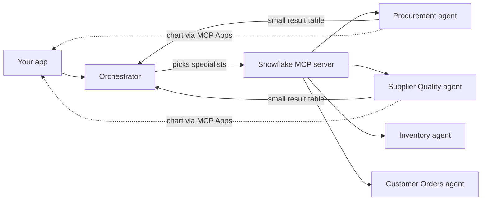
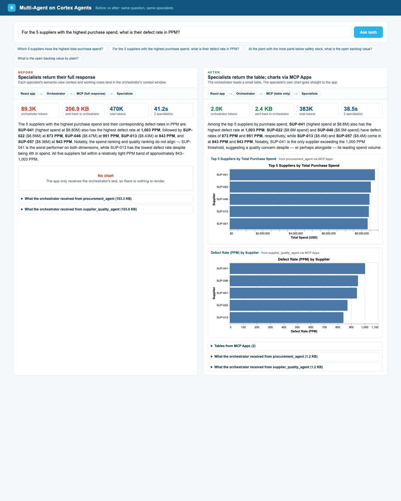

# Multi-Agent with Cortex Agents: What's Changed

This guide is for teams that already run a multi-agent setup on Cortex Agents: an orchestrator that calls
specialist agents for each business domain. It explains what changed in the Snowflake-managed MCP server,
why that lowers token cost, and how to move to the new approach. The demo builds the old and new approaches
side by side so you can compare them in your own account.

**Presenting this?** Follow [`DEMO_SCRIPT.md`](DEMO_SCRIPT.md): a 15-minute walkthrough of the live app, the slides, and likely questions.

---

## Why teams build multi-agent

A manufacturer's data lives in several domains, such as procurement, supplier quality, inventory and customer
orders. Each is owned by a different team with its own semantic views and business rules. A multi-agent
design lets each team own an agent for its domain, while users get **one place to ask**. An orchestrator
picks the specialists a question needs, combines their answers, and returns a chart your app can show.

## What was happening before

There were two common ways for an orchestrator to call specialist agents:

| | Stored procedure + `DATA_AGENT_RUN` | MCP server, full response |
|---|---|---|
| How | A custom tool runs a procedure that calls the specialist agent | The orchestrator calls each specialist through the managed MCP server |
| What comes back | The specialist's written answer only | Everything the specialist did: semantic model context, chart instructions, SQL, text (~137 KB per call) |
| Effect | The orchestrator can't chart text, so it often asks the specialist again (each repeat is a full agent run), and numbers come back rounded | The orchestrator reads and pays for all of it on every call |

## What's changed

The Snowflake-managed MCP server now lets the orchestrator decide what comes back, and can send charts
directly to your app.

| Capability | What it does | Why it cuts tokens |
|---|---|---|
| **Response filtering** (`content_cel_filter`) | Return only the result table, or a `compact` answer (now the default) | The orchestrator reads ~1.6 KB instead of ~137 KB per call |
| **`AGENT_RUN_RESULT`** | Fetch other parts of a finished run later | You pay for detail only when it's used |
| **MCP Apps** (preview) | The specialist's finished chart and table go straight to your app | Charts never pass through the orchestrator |
| **Background runs** | Long questions run asynchronously and can be polled | No client timeouts and retries |



Each specialist still does its own work with its own semantic view. Only a small table travels back to the
orchestrator, and the chart goes straight to the screen.

## Results

Four independent specialist agents, each with a ~15K-token semantic view. Six questions: four need one
specialist and two need two. 18 runs per pattern, Claude Sonnet. Averages per question:

| | Before: stored procedure | Before: MCP full response | **Now: MCP filtered + MCP Apps** |
|---|---|---|---|
| Total tokens | 429K | 289K | **258K** |
| Orchestrator tokens | 93K | 40K | **1.1K** |
| Full-price (uncached) tokens | 74K | 66K | **22K** |
| Response time | 50 s | 31 s | **28 s** |
| Data back to the orchestrator | text only | ~137 KB per call | **~1.6 KB per call** |
| Chart in your app | 83% | — | **100%** |
| Correct answers | 67% | 100% | **100%** |

What changed:

- **vs the stored-procedure pattern:** 40% fewer tokens, 1.8x faster, and every answer exact. The procedure
  pattern sometimes re-asked a specialist (up to 4 calls on a two-domain question) and rounded numbers.
- **vs the full MCP response:** the orchestrator's own tokens drop 97% (40K → 1.1K), and full-price tokens
  drop 66%. Total tokens drop 11%, because most of what remains is each specialist doing its own work.
- **Routing:** the orchestrator called exactly one specialist for single-domain questions and exactly two
  for two-domain questions.

## How to move to the new approach

1. **Keep your specialist agents.** Make sure each has `data_to_chart` so it can produce a chart.
2. **Expose them through one managed MCP server,** one `CORTEX_AGENT_RUN` tool per specialist, each with a
   clear description of when to use it.
3. **In the orchestrator, set `content_cel_filter`** to the result table (`content.filter(c, c.type == 'table')`)
   or `compact`. Don't use `full` for agent-to-agent calls.
4. **Draw charts from MCP Apps.** Each result's `structuredContent._mcp_app.blocks` contains a ready-to-draw
   Vega-Lite chart spec and the table rows.
5. **Retire the stored-procedure wrappers.**

```sql
CREATE MCP SERVER my_db.my_schema.specialist_agents FROM SPECIFICATION $$
tools:
  - name: "procurement_agent"
    type: "CORTEX_AGENT_RUN"
    identifier: "MY_DB.MY_SCHEMA.PROCUREMENT_AGENT"
    title: "Procurement"
    description: "Purchase orders, spend, units and prices by supplier, part, plant and date"
  - name: "supplier_quality_agent"
    type: "CORTEX_AGENT_RUN"
    identifier: "MY_DB.MY_SCHEMA.SUPPLIER_QUALITY_AGENT"
    title: "Supplier Quality"
    description: "Inspections, defects, defect rate (PPM) and NCRs by supplier, part and plant"
$$;
```

```json
{
  "jsonrpc": "2.0", "id": 1, "method": "tools/call",
  "params": {
    "name": "procurement_agent",
    "arguments": {
      "text": "Which 5 suppliers have the highest total purchase spend?",
      "content_cel_filter": "content.filter(c, c.type == 'table')"
    }
  }
}
```

---

## Try it yourself

**You'll need:**
- A Snowflake account with Cortex Agents and Claude Sonnet
- A warehouse
- A role that can create databases, agents, procedures and MCP servers
- MCP Apps enabled on the account (preview; ask your Snowflake account team)

**1. Create the demo objects.** Open [`setup.sql`](setup.sql) in a Snowsight worksheet, replace
`COMPUTE_WH` with your warehouse name, and run all. It creates `MULTIAGENT_DEMO.DEMO` with:

| Object | What it is |
|---|---|
| `PROCUREMENT_AGENT`, `SUPPLIER_QUALITY_AGENT`, `INVENTORY_AGENT`, `ORDERS_AGENT` | The four specialist agents, each with its own semantic view |
| `ORCHESTRATOR_SPROC` + `ASK_*_AGENT` procedures | Before: stored-procedure pattern |
| `SPECIALIST_AGENTS_MCP` | The MCP server for the "before" (full response) and "now" (filtered) patterns |
| `ORCHESTRATOR_TOOLSET` | Appendix: agent toolset pattern |

**2. Run the before/after app.** A small React app plays the role of your front end. It asks the same
question two ways, side by side:

- **Before:** specialists return their full response. Watch how much lands in the orchestrator, and note
  that the app gets text with no chart.
- **After:** specialists return only the result table. The orchestrator stays small, and the app draws each
  specialist's chart from MCP Apps.

```bash
pip install -r requirements.txt
export SNOWFLAKE_ACCOUNT=<org>-<account> SNOWFLAKE_PAT=<token>
cd app && uvicorn server:app --port 8000      # open http://localhost:8000
```

The token stays in the local Python backend (`app/server.py`), which plays the orchestrator. The browser
only talks to that backend.

**Or run it in Snowflake.** [`app/spcs_service.sql`](app/spcs_service.sql) deploys the same app as a Snowpark
Container Services service, with no Docker build. It uses the stock Python image, mounts the app code from a
stage, and calls Cortex with the service's own token. Open the endpoint URL and sign in with your Snowflake
user. Expand *"What the orchestrator received"* on each side to see the actual payload.



You can also connect Claude Desktop or Cortex Code Desktop to `SPECIALIST_AGENTS_MCP`, ask `procurement_agent`
the spend question, and the chart arrives as an interactive card.

**3. Measure it.** With a [programmatic access token](https://docs.snowflake.com/en/user-guide/programmatic-access-tokens):

```bash
export SNOWFLAKE_ACCOUNT=<org>-<account> SNOWFLAKE_USER=<user> SNOWFLAKE_PAT=<token>
python3 measure.py --pattern all --reps 3      # writes results/results_all.csv
```

`measure.py` asks the six questions in [`questions.json`](questions.json) through each pattern. For each
answer it records tokens, response time, data returned to the orchestrator, whether a chart arrived, and
whether the answer matched the true value.

**4. Clean up:** `DROP DATABASE IF EXISTS MULTIAGENT_DEMO;`

Slides: [`docs/Multi-Agent_on_Cortex_Agents.pptx`](docs/Multi-Agent_on_Cortex_Agents.pptx)

## Appendix: agent toolsets

If Snowflake Intelligence is your front end, you can also attach the specialists to an orchestrator with
`agent_toolset`. The orchestrator borrows their tools and runs them itself, with native charts. In this test
it averaged 247K tokens and 20 s per question. It works well with a handful of specialists. With many, every
borrowed tool is listed on each step, so cost grows. For your own app, use the MCP approach above.

## Notes

- The data is synthetic and deterministic, so the true answers in `questions.json` match every deploy.
  Your numbers will vary with your semantic views, questions and models.
- Token counts include cached tokens, which are billed at a discount. "Full-price tokens" excludes them.
- MCP Apps is a preview feature and its behavior may change.
- The earlier version of this demo is in [`legacy/`](legacy/).
