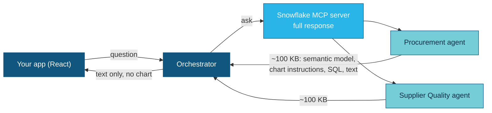
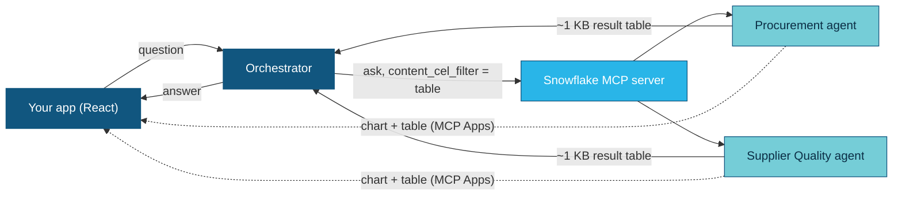
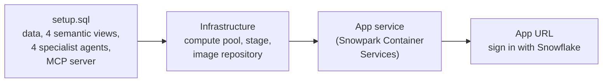

# Multi-Agent with Cortex Agents: Before vs After

A front-end app asks one **orchestrator**, which calls **specialist agents** (one per business domain)
through the Snowflake-managed MCP server. This demo shows what changed in that flow, and measures the
difference in **accuracy, cost and latency** live, side by side.


**Quick links:** [Set it up](#set-it-up-one-command) · [Show it](#show-it) ·
[Pull the metrics](#pull-the-metrics) · [Results](#results) · [Demo script](DEMO_SCRIPT.md) ·
[Slides](docs/Multi-Agent_on_Cortex_Agents.pptx)

---

## Why multi-agent

Each domain (procurement, supplier quality, inventory, customer orders) is owned by a different team with
its own semantic views. Giving each team its own agent keeps that ownership clear. Users still get **one
place to ask**: an orchestrator picks the specialists a question needs, combines their answers, and the app
shows a chart.

## Before: what went wrong



1. **The orchestrator paid to read every specialist's semantic model.** Each call returned the specialist's
   whole working context, about 100 KB, into the orchestrator's context window.
2. **The app got no chart.** What reached the app was text, so there was nothing to render. Wrapping
   specialists in stored procedures (`DATA_AGENT_RUN`) had the same problem: text only, and rounded numbers.

## After: what changed



| New MCP capability | What it does | Effect |
|---|---|---|
| **Response filtering** (`content_cel_filter`) | Specialists return only the result table (or `compact`, now the default) | The orchestrator reads ~1 KB instead of ~100 KB per call |
| **MCP Apps** (preview) | The specialist's finished chart and table go straight to the app | Charts never pass through the orchestrator |
| **`AGENT_RUN_RESULT`** | Fetch other parts of a finished run later | You pay for detail only when you use it |
| **Background runs** | Long questions run asynchronously | No client timeouts |

## Results

Same 6 questions (4 need one specialist, 2 need two), same data, same model (Claude Sonnet), 18 runs per
pattern:

| | Before: stored procedure | Before: MCP full response | **After: MCP filtered + MCP Apps** |
|---|---|---|---|
| **Accuracy**: correct answers | 67% | 100% | **100%** |
| **Cost**: credits per question | 0.246 | 0.233 | **0.139** (about 40% lower) |
| **Latency**: median | 35 s | 28 s | **21 s** |
| Orchestrator tokens | 93K | 40K | **1.1K** |
| Chart in the app | after re-asking | no | **every answer** |

Credits come from `SNOWFLAKE.ACCOUNT_USAGE.CORTEX_AGENT_USAGE_HISTORY`, where cached tokens bill at a lower
rate. The orchestrator's own tokens are the full-price kind, which is why cost falls more than token count
does. Most of what's left is each specialist doing its actual work.

---

## Set it up (one command)

**You need:**
- A Snowflake account with Cortex Agents and Claude Sonnet
- A warehouse
- A role that can create databases, agents, compute pools and integrations (ACCOUNTADMIN works)
- A [programmatic access token](https://docs.snowflake.com/en/user-guide/programmatic-access-tokens) for your user
- The [Snowflake CLI](https://docs.snowflake.com/en/developer-guide/snowflake-cli/installation/installation)
  and `crane` (`brew install crane`) or Docker
- **MCP Apps** enabled on the account for the charts (preview; ask your Snowflake account team)

```bash
export SNOWFLAKE_ACCOUNT=<org>-<account>  SNOWFLAKE_USER=<user>  SNOWFLAKE_PAT=<token>
./deploy.sh <warehouse>
```

It takes about a minute (2–4 the first time) and prints the app URL. Open it and sign in with your
Snowflake user.



Everything is created in `MULTIAGENT_DEMO.DEMO`. Running `deploy.sh` again updates it in place, with the
same URL.

**Prefer your laptop?** Run `./run_local.sh` (same env vars plus `DEMO_WAREHOUSE`) after `setup.sql`, then
open http://localhost:8000.

## Show it

1. Click a sample question. **Before** and **After** run the same question at the same time.
2. Compare the panels:
   - **Before:** ~100–200 KB sent to the orchestrator, tens of thousands of orchestrator tokens, and
     **No chart**.
   - **After:** ~1–2 KB, about 1K orchestrator tokens, and the specialists' own charts.
3. Expand **"What the orchestrator received"** on each side to show the actual payload.
4. The **Running comparison** at the top averages every question asked so far: cost per question,
   latency, orchestrator tokens, data size and charts.

The full talk track is in [`DEMO_SCRIPT.md`](DEMO_SCRIPT.md).

## Pull the metrics

Every question asked in the app is logged to `MULTIAGENT_DEMO.DEMO.DEMO_RUNS`. Open
[`metrics.sql`](metrics.sql) in a Snowsight worksheet:

| Query | Shows |
|---|---|
| 1 | Before vs after: credits per question (and per 1,000), median and average latency, tokens, data size, % with charts |
| 2 | One row with the % change for cost, latency, orchestrator tokens and data size |
| 3 | **Billed** credits from `ACCOUNT_USAGE`, matched to each app run (can lag up to an hour) |
| 4 | Every run, newest first |

Reset the scoreboard before a customer session with `TRUNCATE TABLE MULTIAGENT_DEMO.DEMO.DEMO_RUNS;`.

**Optional benchmark:** `python3 measure.py --pattern all --reps 3` runs the 6 questions through all three
patterns (plus the appendix pattern) and writes `results/results_all.csv`. This is how the Results table
above was produced.

## How to adopt it

1. Keep your specialist agents. Make sure each has `data_to_chart`.
2. Expose them through one managed MCP server, one `CORTEX_AGENT_RUN` tool per specialist.
3. In the orchestrator, call each specialist with
   `"content_cel_filter": "content.filter(c, c.type == 'table')"`. Don't use `full`.
4. In the app, draw charts from each result's `structuredContent._mcp_app.blocks` (a Vega-Lite spec and the
   table rows).
5. Retire the stored-procedure wrappers.

See `app/server.py` for a working orchestrator (about 100 lines) and `app/index.html` for the React side.

## What's in the repo

```
deploy.sh            one-command setup in Snowflake (prints the app URL)
run_local.sh         run the app on your laptop instead
setup.sql            data, semantic views, specialist agents, MCP server, DEMO_RUNS table
metrics.sql          before/after cost and latency, including billed credits
app/server.py        the orchestrator (before and after modes) and run logging
app/index.html       the React app: side-by-side panels and the running comparison
app/spcs_*.sql       Snowpark Container Services objects (used by deploy.sh)
measure.py           optional benchmark across all patterns
questions.json       benchmark questions and their true answers
results/             our benchmark results
docs/                slides and screenshot
DEMO_SCRIPT.md       15-minute customer walkthrough
legacy/              the earlier version of this demo
```

## Appendix: agent toolsets

If Snowflake Intelligence is the front end, the orchestrator can also borrow the specialists' tools with
`agent_toolset`. It has native charts and cost 0.129 credits / 20 s per question in this test. It works well with
a handful of specialists. With many, every borrowed tool is listed on each step and cost grows. For your own
app, use the MCP approach above.

## Notes

- The data is synthetic and deterministic, so the true answers in `questions.json` hold on every deploy.
  Your numbers will vary with your semantic views, questions and models.
- MCP Apps is a preview feature. Without it, response filtering still works and the app can chart the
  returned table itself.
- When you're done, suspend the service and pool:
  `ALTER SERVICE MULTIAGENT_DEMO.DEMO.BEFORE_AFTER_APP SUSPEND; ALTER COMPUTE POOL MULTIAGENT_DEMO_POOL SUSPEND;`
