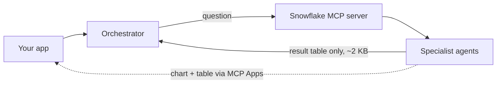

# Multi-Agent with Cortex Agents: What's Changed

This guide is for teams that already run a multi-agent setup on Cortex Agents: an orchestrator agent that
calls specialist agents for each business domain. It explains what changed in the Snowflake-managed MCP
server, why that lowers token cost, and how to move to the new approach. It comes with a demo you can run
to see the difference in your own account.

---

## Why teams build multi-agent

Most organizations don't have one data domain. They have several, such as sales, spend, inventory, quality
and supply chain, and each is owned by a different team with its own semantic views and business rules.

A multi-agent design lets each team own an agent for its domain, while users get **one place to ask
questions**. An orchestrator decides which specialist agents to involve and combines their answers,
ideally with a chart the user's app can display.

## The problem with the original approach

Until recently, there were two common ways to have an orchestrator call specialist agents:

1. **Wrap each specialist in a stored procedure** that calls `DATA_AGENT_RUN`, and give the orchestrator
   those procedures as tools.
2. **Call each specialist through the managed MCP server**, which by default returned the specialist's
   full response.

Both work, but both send too much, or the wrong thing, back to the orchestrator:

- **Answers come back as text.** The specialist's table and chart are flattened into prose. The orchestrator
  can't chart prose, so it asks the specialist again, and each repeat is a full agent run. Numbers often come
  back rounded.
- **Or the entire response comes back.** With the full MCP response, the orchestrator receives everything the
  specialist did: its semantic model context, chart instructions, SQL and text. That's about 140 KB per call,
  and the orchestrator has to read all of it.

That is where the extra tokens were coming from.

## What's changed

The Snowflake-managed MCP server now gives the orchestrator control over what comes back, and can deliver
charts directly to your app.

| New capability | What it does | Why it cuts tokens |
|---|---|---|
| **Response filtering** (`content_cel_filter`) | Choose what each specialist returns: `compact`, or only the result table. `compact` is now the default. | The orchestrator reads ~2 KB, not ~140 KB, per specialist call. |
| **Fetch more later** (`AGENT_RUN_RESULT`) | Retrieve other parts of a finished run only if you need them. | You pay to read detail only when it's used. |
| **MCP Apps** (preview) | The specialist's finished chart and table are delivered to your app, separately from what the orchestrator reads. | The orchestrator never handles the chart, and nobody rebuilds it. |
| **Background runs** (`background: true`) | Long questions run asynchronously and can be polled. | Avoids client timeouts and retries. |



The specialist still does its own work with its own semantic views. Only a small, structured result travels
back to the orchestrator, and the chart goes straight to the screen.

## What the difference looks like

Same data, same questions, same model (Claude Sonnet). Each specialist uses a realistically sized semantic
view (~17K tokens). Averages per question:

| | Stored-procedure wrappers | MCP, full response | **MCP, filtered + MCP Apps** |
|---|---|---|---|
| Tokens per question | ~806K | ~297K | **~256K** |
| Response time | ~102 s | ~26 s | **~25 s** |
| Data sent back to the orchestrator | text only | ~140 KB per call | **~2 KB per call** |
| Chart in your app | no | buried in the full response | **yes, delivered separately** |
| Exact numbers | often rounded | yes | **yes** |
| With 14 specialist agents | — | — | **no increase** |

Moving from stored-procedure wrappers to filtered MCP plus MCP Apps used **about 70% fewer tokens** and
answered **about 4x faster**. Compared with the full MCP response, it cut about 14% of tokens. The tokens
billed at the full (uncached) rate dropped by about half, because the orchestrator stopped re-reading
large payloads.

> **If you use Snowflake Intelligence / CoWork as your front end with a handful of specialists,**
> attaching specialists with `agent_toolset` is also a good option: it costs about the same and charts
> natively. It grows more expensive as you add many specialists (about 1.5x at 14 agents), which is where
> the MCP approach holds steady.

## How to move to the new approach

1. **Keep your specialist agents as they are.** Make sure each has `data_to_chart` and SQL execution tools,
   so it can produce a table and a chart.
2. **Expose them through a managed MCP server**, one `CORTEX_AGENT_RUN` tool per specialist, with a clear
   description of when to use it.
3. **In your orchestrator, set `content_cel_filter`** on each call: `compact`, or only the table
   (`content.filter(c, c.type == 'table')`). Never use `full` for agent-to-agent calls.
4. **Render charts from MCP Apps.** Read `structuredContent._mcp_app.blocks` from each result. It contains
   a ready-to-draw Vega-Lite chart spec and the table rows, so your app draws them directly.
5. **Retire the stored-procedure wrappers** once the MCP path is in place.

Example MCP server:

```sql
CREATE MCP SERVER my_db.my_schema.domain_agents FROM SPECIFICATION $$
tools:
  - name: "sales_agent"
    type: "CORTEX_AGENT_RUN"
    identifier: "MY_DB.MY_SCHEMA.SALES_AGENT"
    title: "Sales"
    description: "Revenue, orders and units by product, region and date"
  - name: "inventory_agent"
    type: "CORTEX_AGENT_RUN"
    identifier: "MY_DB.MY_SCHEMA.INVENTORY_AGENT"
    title: "Inventory"
    description: "On-hand stock, safety stock and inventory value by product and plant"
$$;
```

Example call from your orchestrator:

```json
{
  "jsonrpc": "2.0", "id": 1, "method": "tools/call",
  "params": {
    "name": "sales_agent",
    "arguments": {
      "text": "Top 5 products by revenue",
      "content_cel_filter": "content.filter(c, c.type == 'table')"
    }
  }
}
```

The orchestrator reads the small table in `content`. Your app draws the chart from `structuredContent._mcp_app`.

---

## Try it yourself

The demo builds the old and new approaches side by side, so you can compare them in your account.

**You'll need:**
- Cortex Agents with Claude Sonnet
- A warehouse
- A role that can create databases, agents, procedures and MCP servers
- A [programmatic access token](https://docs.snowflake.com/en/user-guide/programmatic-access-tokens)
- Python 3.10+
- MCP Apps enabled on the account (ask your Snowflake account team)

```bash
pip install snowflake-connector-python requests pandas tabulate

export SNOWFLAKE_ACCOUNT=<org>-<account>
export SNOWFLAKE_USER=<user>
export SNOWFLAKE_PAT=<token>
export SNOWFLAKE_HOST=https://<org>-<account>.snowflakecomputing.com
export DEMO_WAREHOUSE=<warehouse>

cd setup && python3 gen_scale.py && python3 run_setup.py    # builds MULTIAGENT_DEMO.BENCH
```

**See it live.** In Snowsight, ask `MASTER_SPROC_AGENT` (the old approach):
*"Show me sales by product for the top 5 products."* Open the trace, and you'll see the chart step fail on
text and the sales agent being called again. Then connect Claude Desktop or Cortex Code Desktop to the
`BENCH_MCP` server and ask `sales_agent` the same question. The chart arrives as an interactive card.

**Measure it.**

```bash
cd ../bench
python3 bench_sproc.py 3    # old: stored-procedure wrappers
python3 bench.py 3          # MCP with full / compact / table-only responses
python3 bench_apps.py 3     # MCP + MCP Apps
python3 ../results/summarize.py
```

**Clean up:** `DROP DATABASE IF EXISTS MULTIAGENT_DEMO;`

More detail: [docs/findings.md](docs/findings.md) · Slides: [docs/multiagent-delegation-findings.pptx](docs/multiagent-delegation-findings.pptx)

## Notes

- The data is synthetic. Your numbers will vary with your semantic views, questions and models.
- Token counts include cached tokens, which are billed at a discount.
- MCP Apps is a preview feature and its behavior may change.
- The earlier version of this demo is in [`legacy/`](legacy/).
